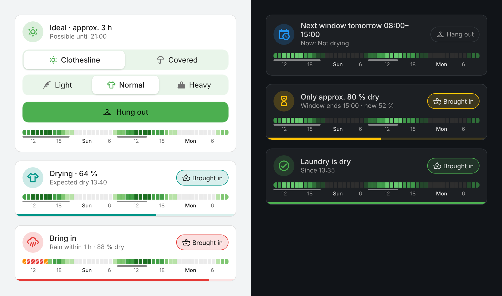

# DryingPilot – laundry drying forecast & tracker for Home Assistant



DryingPilot tells you whether your laundry will dry outside – and when. It combines
the hourly weather forecast with optional outdoor sensors and PV power to show
the current drying status, upcoming drying windows, how long drying is possible
and, once the laundry is out, its progress and when it is expected to be dry.

**Languages:** English · Deutsch · Français · Español
(follows the language set in Home Assistant; English is used as fallback)

## Features

- Drying status from *Not drying* to *Ideal*, based on vapour pressure deficit, wind and sun
- Drying windows in the 48 h forecast and "possible until"
- Progress tracking with "expected dry" once the laundry is out
- Pre-drying: when no full window is in sight, partial windows (≥ 3 h) are shown with their gain
- Clear "not drying right now" state with the expected finish time instead of outdated times
- Clothesline or covered: sun only counts on the line, rain only matters on the line
- Built-in dashboard card – no extra frontend downloads
- Notifications with action buttons (bring in, dry, window ending, good drying weather)
- Self-calibration: learns from a quick "Is the laundry dry?" how fast laundry dries at your spot
- Works with forecast only; outdoor temperature, humidity and PV power improve accuracy

## Installation

### Marketplace / HACS (recommended)

1. Open the Marketplace (HACS) → ⋮ → *Custom repositories*
2. Add `https://github.com/BlackBird8018/ha-drying-pilot` as type **Integration**
3. Download **DryingPilot** and restart Home Assistant
4. *Settings → Devices & services → Add integration* → **DryingPilot**

### Manual

Copy `custom_components/drying_pilot` to `<config>/custom_components/` and restart.

## Configuration

| Field | Required | Purpose |
|---|---|---|
| Weather forecast | yes | Weather entity with hourly forecast |
| Outdoor temperature | no | Live value for the current hour (sensor in the shade) |
| Outdoor humidity | no | Live value; if missing, derived from the forecast dew point |
| PV power | no | Sunshine proxy; without it cloud cover and UV index are used |

Model parameters, drying targets and notifications can be changed later under
*Devices & services → DryingPilot → Configure*.

## Dashboard card

DryingPilot ships its own card and registers it automatically. In the dashboard:
*Edit → Add card → DryingPilot*.

```yaml
type: custom:drying-pilot-card
entity: sensor.laundry_drying_mode
show_forecast: true
```

The tile adapts to the current mode, lets you start drying right from the card
(clothesline/covered, light/normal/heavy) and optionally shows a 48 h forecast
strip with the drying windows. After an update, reload the browser/app once.

**Forecast strip** – hover over an hour to see what happens (e.g. *Mon 14:00 · drying 18 %/h*, *rain 1.2 mm (75 %)*, *laundry gets damp (air 93 %)*). On touch screens, tap an hour: the info line and the legend appear; tap again to hide them. The %/h value refers to the selected laundry type and spin speed.

Colours:

| Colour | Meaning |
|---|---|
| Green, light → strong | Slow, moderate, good, ideal drying (stronger = faster) |
| Grey | Not drying |
| Red, densely hatched | Rain likely (> 60 % or ≥ 1 mm) |
| Orange, sparsely hatched | Rain possible |
| Soft blue, three tones | Humidity while laundry hangs: humid air → barely drying → laundry gets damp |
| Solid / dashed line | Drying window / pre-drying window |

## Notifications

Choose recipients (companion app devices) and notification types in the options:

| Notification | When | Action button |
|---|---|---|
| Bring in | Rain within 1 h (clothesline only) or air turning humid | Brought in |
| Laundry is dry | Target reached | Brought in |
| Window ending soon | Target not reachable, less than 1 h before the window ends | Brought in |
| Good drying weather | A window starts and no laundry is out (max. once a day, off by default) | Hung out |
| Iron-damp | About 85 % dry – ideal for ironing (off by default) | Brought in |
| Pre-drying possible | A partial window starts, no full window in sight (max. once a day, off by default) | Hung out |
| Pre-drying finished | The partial window is over – bring in and finish indoors (off by default) | Brought in |

Each notification is sent at most once per drying run.

## Self-calibration

When DryingPilot expects the laundry to be dry, it asks **"Is the laundry dry?"** – on the
card and, if notifications are set up, on your phone:

| Answer | What happens |
|---|---|
| Dry | Learned; no further questions this run |
| Still damp | Learned; the estimate is recalculated and DryingPilot asks again later |
| Don't know | Nothing learned, no further questions this run |
| Ask later | Asks again in one hour |

When you bring the laundry in from the card, it can also ask "How was the laundry?".

DryingPilot learns two factors per location (clothesline / covered): an overall factor
(load, fabric, shade) and the share of the forecast wind that actually reaches your
drying spot. Both start at 1 and only move when the answers support it; typically
10–20 answers are enough. Answers after rain or after the laundry got damp again, and
runs longer than 24 h, are ignored.

- Turn learning on/off with the switch **Learn from feedback** on the device page
- The **Calibration** sensor shows the state and the learned factors
- Reset under *Configure → Reset calibration*
- Runs are stored locally (`.storage/drying_pilot.<entry>.history`) with the raw weather
  trace, so the calibration can be recomputed when the model improves

## How it works

```
VPD  = e_s(T) · (1 − RH/100)                              vapour pressure deficit [hPa]
rate = k · [ (a + b · f · wind^0.7 · 12^0.3) · VPD · w_aero(T) + s · sun · w_rad(T) ]   [%/h]
```

The wind effect saturates (wind^0.7, equal to the linear form at 12 km/h).

`w_aero` and `w_rad` follow the Penman combination equation (normalised at 15 °C):
dry air matters more in the cold, sunshine more in the warmth. `k` and `f` are the
calibration factors.

100 % means a normal load is dry. The displayed progress follows the two drying
phases: water leaves fast while the surface is wet, the last ~30 % (from inside the
fibres) slowly – "90 %" really feels almost dry. The spin speed of your washing
machine (options, default 1400 rpm) scales how much water there is at the start. Targets per laundry type: light 70 %,
normal 100 %, heavy 150 %. The sun bonus only applies on the clothesline.

| Status | Rate |
|---|---|
| Not drying | < 5 %/h |
| Slow | 5–10 %/h |
| Moderate | 10–17 %/h |
| Good | 17–30 %/h |
| Ideal | > 30 %/h |

The current hour uses live sensor values; the offset between sensor and
forecast is carried over to the following hours and fades out (τ = 3 h).

**Rewetting:** laundry takes up moisture again from 90 % relative humidity, or on
clear nights when the air is less than 3 K above its dew point (dew forms on the
laundry). A humid phase ends at 86 % (hysteresis) and must last 30 minutes before
DryingPilot warns. All thresholds can be changed in the options.

## Entities

| Entity | Meaning |
|---|---|
| Mode | `indoor`, `later`, `pre_dry`, `hang_now`, `drying`, `tight`, `paused`, `bring_in`, `dry`; attributes `title`, `subtitle`, `tile_icon`, `color` |
| Status | Category (Not drying … Ideal) |
| Drying rate | %/h; attributes `forecast` (hourly: `rate`, `pct`, `blocked`, `rain`, `rain_mm`, `rain_probability`, `humid` 0–3, `humidity`) and `windows` for charts |
| Vapour pressure deficit | hPa |
| Progress | % of target (only while laundry is out) |
| Possible until / Expected dry / Next window start / end | Timestamps |
| Bring in / Dry | Binary sensors for automations |
| Location / Laundry type | Selects |
| Hung out / Brought in | Buttons |

## Actions

```yaml
action: drying_pilot.start
data:
  location: line        # line | covered
  laundry_type: normal  # light | normal | heavy

action: drying_pilot.stop
data:
  feedback: dry         # optional: dry | damp | unknown

action: drying_pilot.feedback
data:
  answer: damp          # dry | damp | unknown | later
```

## Translations

Translations live in `custom_components/drying_pilot/translations/*.json` (config,
entities, actions), `custom_components/drying_pilot/i18n.py` (tile texts and
notifications) and the `I18N` table in `frontend/drying-pilot-card.js`.
Corrections and new languages are welcome as pull requests.

## Development

```bash
python3 -m pytest
```

The calculation core (`model.py`), texts (`texts.py`, `i18n.py`) and
notification logic (`notify.py`) have no Home Assistant dependency and are
tested offline, including against a real forecast (`tests/fixtures`).

## License

Apache License 2.0 – see [LICENSE](LICENSE).
